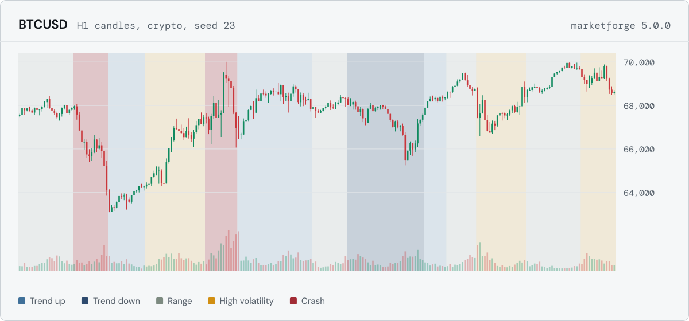
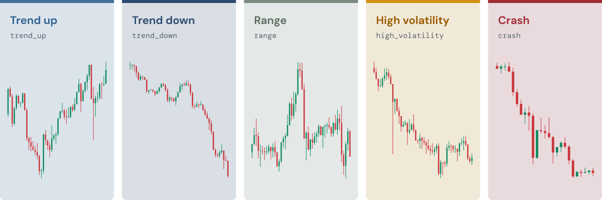
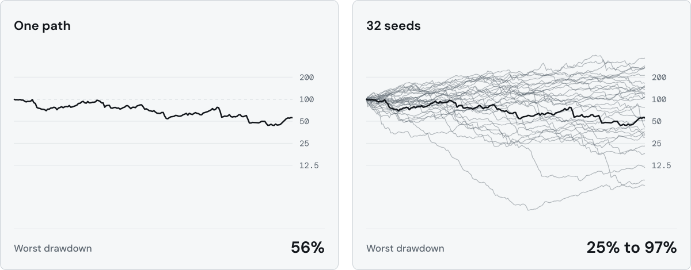

<p align="center">
  <picture>
    <source media="(prefers-color-scheme: dark)" srcset="https://raw.githubusercontent.com/DamienReichhart/MarketForge/main/docs/brand/assets/lockup-dark.svg">
    
  </picture>
</p>

<h3 align="center">Synthetic market data for training trading models</h3>

<p align="center">
  208 crypto, forex and US stock instruments, simulated minute by minute on their real trading calendars.<br>
  Every candle labelled with the market regime behind it. Every dataset reproducible from its seed.
</p>

<p align="center">
  <a href="https://pypi.org/project/marketforge/"></a>
  <a href="https://pypi.org/project/marketforge/"></a>
  <a href="https://github.com/DamienReichhart/MarketForge/blob/main/LICENSE"></a>
  <a href="https://damienreichhart.github.io/MarketForge/docs/"></a>
</p>

<p align="center">
  <a href="https://damienreichhart.github.io/MarketForge/playground/"><b>Try it in your browser</b></a>
  &nbsp;&nbsp;&nbsp;
  <a href="https://damienreichhart.github.io/MarketForge/docs/quick-start/"><b>Quick start</b></a>
  &nbsp;&nbsp;&nbsp;
  <a href="https://damienreichhart.github.io/MarketForge/docs/"><b>Documentation</b></a>
  &nbsp;&nbsp;&nbsp;
  <a href="https://damienreichhart.github.io/MarketForge/changelog/"><b>Changelog</b></a>
</p>

<picture>
  <source media="(prefers-color-scheme: dark)" srcset="https://raw.githubusercontent.com/DamienReichhart/MarketForge/main/docs/readme/hero-dark.svg">
  
</picture>

```bash
pip install marketforge
marketforge generate -o ./data --from 2024-01-01 --days 90 --markets crypto --with-regime --with-spread --seed 42
```

That is 90 days of all 53 crypto instruments, the eight standard timeframes
from `m1` to `W1`, with the regime and the bid-ask spread of every candle:
about 700 MB of CSV in ten seconds (`--format parquet` writes less than half,
and `--dry-run` tells you before anything is written). Parquet, Feather and
pandas DataFrames work too. Run it again with seed 42 and you get the same
candles, bit for bit. Or skip the install: the
[playground](https://damienreichhart.github.io/MarketForge/playground/) runs
the same package in a browser tab.

## Why it exists

Real market history is one path. It is finite, expensive, unlabelled, and it
leaks into every model you fit on it. MarketForge gives you as many paths as
you need, each one labelled and each one reproducible.

| You want to | MarketForge gives you | Guide |
| --- | --- | --- |
| **Train or pre-train a model** | Unlimited realistic sequences with the true regime of every candle as a label, and disjoint seeds for train, validation and test sets that share no path. | [Machine learning](https://damienreichhart.github.io/MarketForge/docs/use-cases/machine-learning/) |
| **Test a backtester** | NYSE sessions, holidays, early closes and DST; the forex week; 24/7 crypto; overnight and weekend gaps; mid prices plus a spread; panels that do not trade at the same times. | [Backtesting](https://damienreichhart.github.io/MarketForge/docs/use-cases/backtesting/) |
| **Stress-test a strategy** | Hundreds of alternative histories, crash and high-volatility regimes included, with optional spikes and flash crashes, and the distribution of drawdowns instead of one equity curve. | [Stress testing](https://damienreichhart.github.io/MarketForge/docs/use-cases/stress-testing/) |

## Five regimes, one per band of the logo

<picture>
  <source media="(prefers-color-scheme: dark)" srcset="https://raw.githubusercontent.com/DamienReichhart/MarketForge/main/docs/readme/regimes-dark.svg">
  
</picture>

Markets have hidden states, and real data never tells you which one you were
in. MarketForge does: with `--with-regime`, every candle carries the regime the
simulator was in, in the `regime` column. It is a target for supervised
learning, an answer key for regime detectors, and a way to score a strategy
separately in each state. A regime is shared by every instrument of a market,
as in a real sell-off, and trends along the market's main factor, so the labels
show in the data.

## One backtest is one path

<picture>
  <source media="(prefers-color-scheme: dark)" srcset="https://raw.githubusercontent.com/DamienReichhart/MarketForge/main/docs/readme/seeds-dark.svg">
  
</picture>

Six months of BTCUSD, the same model and the same dates, under 32 seeds.
Buy-and-hold's worst drawdown runs from 25% to 97%. A backtest on one history
sees one number from that spread; `generate_many()` gives you the rest, one
seed per process.

> **No alpha in here, by design.** A model trained only on MarketForge learns
> MarketForge. The data has the statistics of real markets but no edge that
> carries over to them, and instrument symbols are labels for parameter sets,
> not the history of those instruments. Use MarketForge to build, debug,
> pre-train and stress-test, and real data to decide whether anything earns
> money. See [What it is not](https://damienreichhart.github.io/MarketForge/docs/limits/).

## What makes the data credible

| | |
| --- | --- |
| **Real trading calendars** | Stocks trade the NYSE session (09:30 to 16:00 New York, DST-aware) and skip NYSE holidays and early closes. Forex trades from Sunday 17:00 to Friday 17:00 New York time. Crypto never closes. No candle is printed while a market is shut, and gaps come from the price moving during the closure, as they do in reality. |
| **One market, one story** | Every instrument of a market is simulated jointly: the correlations the catalog states, Student-t shocks with tail dependence, correlations that intensify in crashes (diversification fails when it matters), and a shared regime. |
| **One world** | A world-wide shock and macro state link the markets: coins move with stocks (BTC-AAPL about 0.3 weekly), and when the world is stressed, crashes come to every market at once. |
| **Real market events** | Stocks report earnings four times a year and gap on them, and have opening and closing auctions; pegged currencies hold their bands; forex thins out at Christmas; every price sits on its tick. |
| **Arbitrage-free forex** | One anchor pair per currency is simulated and every cross is derived from them, so `EURJPY == EURUSD * USDJPY` at every minute, to within the tick each is quoted on. |
| **Validated, not eyeballed** | Heavy tails, volatility clustering, long memory, the leverage effect, intrabar range, autocorrelation, hourly tails, the volume-volatility link and the spread are checked for every instrument, across seeds, against bands measured on real crypto minute data (forex and stock bands are still provisional). The validator ships with the package, and `marketforge calibrate` fits instruments to your own data. |
| **Reproducible** | A seed fixes every random shock by market and minute. The same seed and version give the same EURUSD, bit for bit on a given platform, whether you generate it alone or with 207 other instruments. CI enforces it on every commit. |
| **Extendable** | Every dataset carries a manifest of how it was made. `marketforge extend` continues it with exactly the candles of one longer run (byte-identical in CSV), and `marketforge verify` proves a dataset unaltered. |
| **Built for ML pipelines** | `generate_many()` runs seeds in parallel processes for leak-free splits, `windows()` cuts float32 training windows, `to_numpy()` gives `(time, instrument, feature)` tensors, `read()` loads datasets back with the right types, Feather files load with no copy, and the long layout puts a whole market in one Parquet file. |
| **Fast, bounded memory** | Compiled (Numba) kernels stream the simulation day by day. A year of EURUSD across all 8 timeframes takes about 2 s; a month of all 208 instruments about 6 s. Memory does not grow with the range. |

## Quick start

```bash
# One year of EURUSD, every timeframe, reproducible
marketforge generate -o ./eurusd --from 2024-01-01 --to 2025-01-01 --instruments EURUSD --seed 42

# A whole market as Parquet, with regime labels and the bid-ask spread
marketforge generate -o ./crypto --from 2024-01-01 --days 180 --markets crypto \
    --format parquet --with-regime --with-spread --seed 7

# What would a run produce (files, rows, disk size, time)? Nothing is written.
marketforge generate --from 2015-01-01 --to 2025-01-01 --markets all --dry-run

# Continue a dataset: 30 more days, same seed, instruments, timeframes and format
marketforge extend ./eurusd --days 30

# Check an m1 file against real-market stylized facts (exit code 1 on failure)
marketforge validate ./eurusd/forex/EURUSD_m1.csv
```

Every option is in the
[command-line reference](https://damienreichhart.github.io/MarketForge/docs/reference/cli/).

### Python

```python check=static
import marketforge as mf

if __name__ == "__main__":  # generate_many() starts processes: guard the script
    # Disjoint seeds: train, validation and test never share a path.
    # One generation per seed, in parallel processes, yielded in seed order.
    for data in mf.generate_many(
        "BTCUSD,ETHUSD,SOLUSD", seeds=range(64),
        start="2024-01-01", end="2024-04-01", timeframes=["m5"], with_regime=True,
    ):
        x, y, times, symbols = data.windows("m5", 128)   # float32 windows, regime labels
        ...

# Years of data, streamed to disk; continued later
mf.generate_to_disk("./data", markets="stocks", start="2015-01-01", end="2025-01-01",
                    seed=1, format="parquet")
mf.extend("./data", "2025-02-01")

# Check minute candles against the bands measured on real markets
m1 = mf.generate("BTCUSD", start="2024-01-01", end="2024-01-15", seed=1, timeframes="m1")
print(mf.validate(m1["BTCUSD"]["m1"], "crypto").summary())
```

See the [Python API](https://damienreichhart.github.io/MarketForge/docs/reference/python-api/), and
[`examples/`](https://github.com/DamienReichhart/MarketForge/tree/main/examples) for runnable
scripts: a regime classifier, training windows for a neural network, a backtest that fills at
the quote, and Monte Carlo drawdowns.

## Output

```
data/
├── marketforge.json                       # the manifest: version, seed, range, settings
├── crypto/BTCUSD_m1.csv, BTCUSD_H1.csv, ...
├── forex/EURUSD_m1.csv, ...
└── stocks/AAPL_m1.csv, ...
```

```csv
timestamp,open,high,low,close,volume,spread,regime
1704067200,67500,67547.9,67491.4,67533.6,32.367,0.13284302,range
```

Timestamps are the start of the candle in Unix seconds (UTC), or ISO 8601
with `--timestamps iso`. Prices are mid prices on the instrument's tick (0.1 for
BTCUSD): `bid = price - spread / 2`.
The regime is one of `trend_up`, `trend_down`, `range`, `high_volatility` and
`crash`, in files as in memory (a categorical whose codes are 0 to 4 in that
order). `high >= max(open, close)` and
`low <= min(open, close)` always hold, and partial candles are never written.
See [Output format](https://damienreichhart.github.io/MarketForge/docs/reference/output/).

## Markets

| Market | Instruments | Hours | Calibration |
| --- | --- | --- | --- |
| crypto | 53 (BTCUSD, ETHUSD, SOLUSD, ...) | 24/7 | Validation bands and spreads measured on Binance minute data of seven coins |
| forex | 81: majors, crosses, exotics, metals, index and oil CFDs | Sunday 17:00 to Friday 17:00 New York | Provisional bands; spreads estimated |
| stocks | 74 US large caps (AAPL, MSFT, NVDA, JPM, ...) | NYSE session, holidays, early closes | Provisional bands; spreads estimated |

Change any instrument, or add your own, with a TOML
[override file](https://damienreichhart.github.io/MarketForge/docs/guides/custom-instruments/).
The [model](https://damienreichhart.github.io/MarketForge/docs/reference/model/),
the [spread](https://damienreichhart.github.io/MarketForge/docs/reference/spread/)
and the [known simplifications](https://damienreichhart.github.io/MarketForge/docs/reference/markets/#known-simplifications)
are documented in full.

## Reproducibility

For a given MarketForge **version**, `(seed, market, minute)` fully determines
every random shock. Output is identical whichever instruments, timeframes,
format or `--jobs` you choose, whether the spread or regime is requested, how
far `--to` extends, and whether the range was generated at once or extended in
steps. **Realism comes before seed stability:** any release may change what a
seed produces when that makes the data more realistic, and says so under
*Output changes* in the changelog. Pin the version to keep a dataset
identical; the manifest records the version and model revision that made it.
See
[Reproducibility](https://damienreichhart.github.io/MarketForge/docs/reference/reproducibility/).

## Contributing

```bash
git clone https://github.com/DamienReichhart/MarketForge && cd MarketForge
pip install -e . --group dev    # pip >= 25.1
nox                             # lint, typecheck and tests, as CI runs them
```

These are the checks CI runs; see [`docs/ci-cd.md`](https://github.com/DamienReichhart/MarketForge/blob/main/docs/ci-cd.md) for the
pipeline and the release process, [`docs/adr/`](https://github.com/DamienReichhart/MarketForge/tree/main/docs/adr) for design
decisions, and [`GLOSSARY.md`](https://github.com/DamienReichhart/MarketForge/blob/main/GLOSSARY.md) for the vocabulary. The website
lives in [`website/`](https://github.com/DamienReichhart/MarketForge/tree/main/website). Report security issues privately: see
[`SECURITY.md`](https://github.com/DamienReichhart/MarketForge/blob/main/SECURITY.md).

<details>
<summary><b>Project layout</b></summary>

```
marketforge/
  domain/        Shared vocabulary: markets, regimes, anomalies, timeframes, candles. Imports nothing else.
  calendars/     When each market is open and where its bars start (NYSE rules, DST).
  config/        Model parameters, per-market defaults, TOML overrides.
    catalog/     Built-in instruments and correlations, one package per market.
  simulation/    The day-by-day market simulator and its parts (kernels, factors, regimes, anomalies).
  aggregation/   m1 candles to higher timeframes, streaming.
  output/        CSV and Parquet writers.
  validation/    Stylized-fact metrics and the bands generated data must meet.
  api/           generate() and generate_to_disk(): parsing, planning, execution.
  cli/           The marketforge command, one module per subcommand.
tests/           Mirrors the package, plus tooling/ for the release scripts.
website/         The documentation site (Astro, Starlight), deployed to GitHub Pages.
```

Each package may import from the ones listed above it, never from the ones
below; `aggregation`, `output` and `validation` do not import each other. CI
enforces this with `lint-imports`. The supported Python API is what
`import marketforge` exposes; module paths below it can change between
releases.

</details>

## License

Apache-2.0. See [LICENSE](https://github.com/DamienReichhart/MarketForge/blob/main/LICENSE)
and [NOTICE](https://github.com/DamienReichhart/MarketForge/blob/main/NOTICE).

The wheel and the sdist contain only MarketForge's own code; pip installs its
dependencies from their own packages, with their own licences. Each
[GitHub release](https://github.com/DamienReichhart/MarketForge/releases) has
a `third-party-licenses.txt` with the licence and NOTICE texts of every
runtime dependency, for whoever ships an environment with MarketForge in it.
The website's are at
[third-party-licenses.txt](https://damienreichhart.github.io/MarketForge/third-party-licenses.txt).

The README's charts are real MarketForge output, drawn by
[`scripts/build_readme_images.py`](https://github.com/DamienReichhart/MarketForge/blob/main/scripts/build_readme_images.py)
in the brand's colours. All data MarketForge produces is synthetic. It is not
the price history of any real instrument, and nothing in this project is
financial advice.
